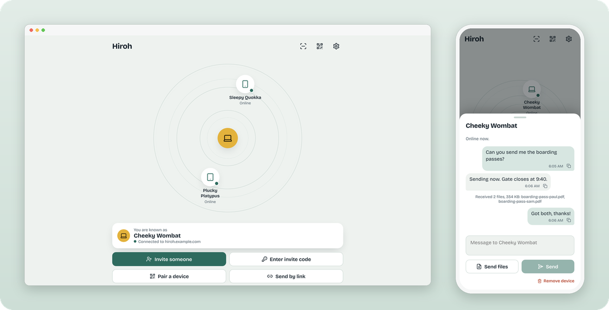
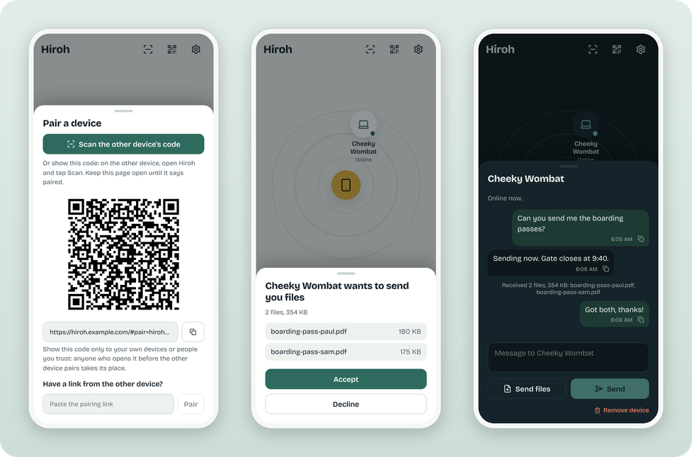

# Hiroh

Self-hosted, end-to-end encrypted file and text sharing between your devices,
in the browser.

<p align="center">
  
</p>

<p align="center">
  <br>
  <sub>Pair with a QR code · Accept or decline every file · Light and dark themes</sub>
</p>

## Requirements

- Linux with Docker and Docker Compose v2. The first build needs about 1.5 GB
  of RAM and 10 GB of free disk.
- A hostname served over HTTPS, for example `hiroh.example.com`. Only port 443
  is needed; there are no UDP ports to open.

## Run it

```sh
git clone https://github.com/Daimon-Law/hiroh.git
cd hiroh
cp .env.example .env
```

Edit `.env`:

```sh
HIROH_SITE_ADDRESS=hiroh.example.com
HIROH_PUBLIC_URL=https://hiroh.example.com/
HIROH_RELAY_TOKENS=alice:<token>,bob:<token>
```

Make a token for each person with `openssl rand -hex 24`. Then:

```sh
docker compose up -d --build
```

The first build takes several minutes. Caddy gets a certificate for the
hostname on first start. Open `https://hiroh.example.com`.

### Behind your own reverse proxy or tunnel

Set these instead, and point your proxy at `http://<docker-host>:8080` for the
whole hostname:

```sh
HIROH_SITE_ADDRESS=:80
HIROH_HTTP_PORT=8080
HIROH_PUBLIC_URL=https://hiroh.example.com/
```

The proxy must pass WebSocket upgrades and append the visitor's address to
`X-Forwarded-For`. Publish `HIROH_HTTP_PORT` only to that proxy (for example
`127.0.0.1:8080:80`, or a firewall rule), not to the whole LAN. Set
`HIROH_CADDY_TRUSTED_PROXIES` to the proxy's address. Then read
[Client addresses](#client-addresses).

### With an existing Traefik

Set `HIROH_HOST`, `TRAEFIK_NETWORK` and `TRAEFIK_ENTRYPOINT` in `.env`, then:

```sh
docker compose -f deploy/traefik/compose.yaml --env-file .env up -d --build
```

## Settings

All settings go in `.env`. [`.env.example`](.env.example) lists them with
comments.

| Variable | Purpose |
| --- | --- |
| `HIROH_SITE_ADDRESS` | Your hostname, or `:80` behind another proxy. |
| `HIROH_PUBLIC_URL` | The HTTPS address people open, with a trailing slash. |
| `HIROH_HTTP_PORT`, `HIROH_HTTPS_PORT` | Host ports for the bundled Caddy. |
| `HIROH_RELAY_TOKENS` | `label:token` pairs, comma separated, one per person. |
| `HIROH_MAX_GUEST_HOURS` | Longest guest access a member can grant. Default 168. |
| `HIROH_DORMANT_HOURS` | Devices unseen this long must register again. Default 24. |
| `HIROH_CLIENT_IP_HEADERS` | Where the visitor's address comes from. See [Client addresses](#client-addresses). |
| `HIROH_TRUSTED_PROXIES` | CIDR ranges whose headers the access service trusts. Default: private ranges. |
| `HIROH_CADDY_TRUSTED_PROXIES` | Proxies in front of the bundled Caddy whose `X-Forwarded-For` it keeps. Default: none. |
| `HIROH_CSP` | Content-Security-Policy: `report` (default), `enforce` or `off`. |
| `HIROH_CSP_CONNECT_EXTRA` | Extra `connect-src` sources, for relays on other hosts. |
| `RUST_LOG` | Relay log level. |

## Client addresses

The access service limits wrong invite PINs and wrong relay tokens to 10 per
address in 15 minutes. It needs the visitor's real address for that, and a
header is only as honest as the proxy that sets it.

- With `HIROH_CLIENT_IP_HEADERS` empty, the service uses the TCP peer address.
  Nobody can forge it, but behind a proxy every visitor shares one address.
  Then one person's 10 wrong PINs block invites for everyone for 15
  minutes, and 10 wrong tokens block every member's device the same way.
  The same happens when a proxy hides addresses (for example Docker's
  userland proxy, which shows every visitor as the Docker gateway).
- A header is read only when the request comes from a trusted proxy
  (`HIROH_TRUSTED_PROXIES`, private ranges by default).
- For `x-forwarded-for` the service reads from the right and takes the first
  address that is not a trusted proxy. Each proxy appends what it saw, so
  entries further left come from the client and are ignored.
- IPv6 addresses are counted per /64.

Set it for your setup:

| What is in front of Hiroh | `HIROH_CLIENT_IP_HEADERS` |
| --- | --- |
| Nothing: the bundled Caddy gets its own certificate | `x-forwarded-for` |
| A reverse proxy or tunnel on your own machine or LAN, then the bundled Caddy (`HIROH_SITE_ADDRESS=:80`) | `x-forwarded-for`, and set `HIROH_CADDY_TRUSTED_PROXIES` to the proxy's address as Caddy sees it |
| A reverse proxy on a public address, then the bundled Caddy | `x-forwarded-for`; set `HIROH_CADDY_TRUSTED_PROXIES` to the proxy's address, and add the proxy's address to `HIROH_TRUSTED_PROXIES` as well |
| Your own Traefik (`deploy/traefik/compose.yaml`) | `x-forwarded-for` |
| Cloudflare (proxied DNS or Cloudflare Tunnel), with any of the above | `cf-connecting-ip` |
| A setup you have not checked | leave it empty |

`cf-connecting-ip` is safe only if Hiroh cannot be reached except through
Cloudflare. If the origin is reachable directly, anyone can send that header.
Use a Cloudflare Tunnel, or allow only
[Cloudflare's addresses](https://www.cloudflare.com/ips/) at your firewall.

The limit per address is one layer. The other does not depend on addresses:
every open invite closes after 100 wrong PINs in total, from anyone, so the
odds of guessing an open PIN stay at 1 in 10,000 at most. A join request
already waiting stays open for the inviter to decide. The trade-off: anyone
who sends 100 wrong PINs closes all open invites. The inviter sees "closed
after too many wrong PINs" and makes a new invite.

## Content-Security-Policy

The web app keeps device keys and the relay token in the browser's local
storage. A Content-Security-Policy limits what an injected script could do
with them. `HIROH_CSP=report` (the default) sends the header in report-only
mode: browsers report violations, and the access service logs them as lines
starting `csp`. Use the app for a full session (pair two devices, send a
file and a message, make and use an invite, scan a QR code). If the access
log shows no `csp` lines, set `HIROH_CSP=enforce` and restart the `web`
service. If your people use a relay on another host, add it with
`HIROH_CSP_CONNECT_EXTRA`.

## Blocking repeat offenders at Cloudflare

If Hiroh is behind Cloudflare, [`deploy/edge/hiroh-guard.js`](deploy/edge/hiroh-guard.js)
is an optional Worker that blocks an address for 24 hours after 5 wrong
invite codes. Route it to `<your host>/api/*` only. On the whole host it would
also block the web app, which locks out everyone behind a shared office or
mobile NAT. Setup steps are at the top of the file.

## Giving people access

Add a `label:token` pair to `HIROH_RELAY_TOKENS` and run `docker compose up -d`.
The person opens your Hiroh address, goes to **Settings**, chooses **Private
relay**, pastes the token, presses **Test**, then **Save**. To revoke someone,
remove their pair and run `docker compose up -d` again.

## Updating

```sh
git pull
docker compose up -d --build
```

## Tests

The access service has tests for its limits; they need only Node 22:

```sh
node --test deploy/access/test/*.test.mjs
```

## Licence

MIT, copyright DexWorks Pty Ltd. See [LICENSE](LICENSE) and
[NOTICE.md](NOTICE.md).
